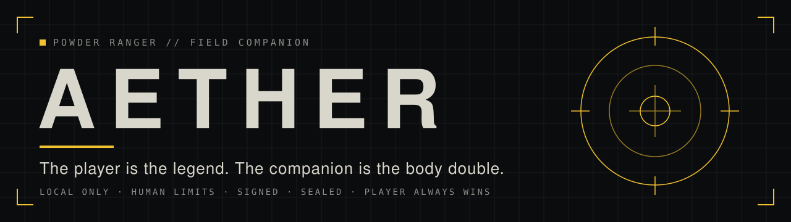
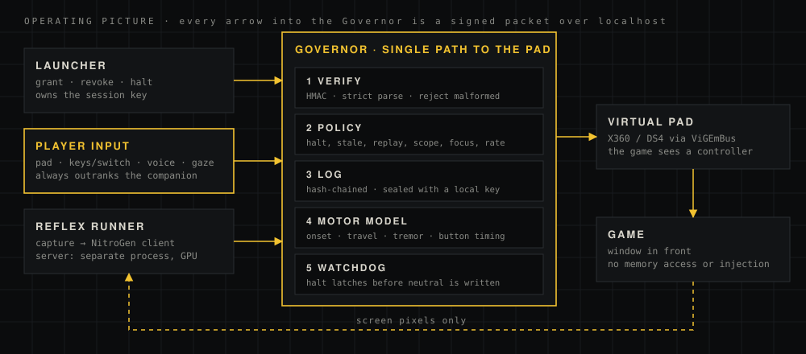

<p align="center"></p>

<p align="center">
<a href="https://github.com/POWDER-RANGER/powder-ranger-bot/actions/workflows/ci.yml"></a>


</p>

A local, accessibility-first game companion. **The player directs; the companion plays** through a virtual controller, from the screen alone. Part of Powder Ranger.

> **The player is the legend. The companion is the body double.**
> Every controller output traces to a player intent or to a delegation the player granted, and the player takes control back at any instant.

## Operating picture

<p align="center"></p>

One process, the **Governor**, owns the virtual controller. Everything else, including the player's own channels, sends it signed intent packets. It decides, logs, and only then moves the pad.

## Rules of engagement

Enforced in `GovernorPolicy`, the Governor and the motor model; the tests in `tests/` cover them.

1. Kill switch latches the halt, revokes all delegations, then writes neutral output. Resume needs a new grant.
2. Packets older than their TTL are dropped; replayed or out-of-order sequence numbers are dropped.
3. Player input always passes and pre-empts the companion for `player_override_hold_ms`.
4. Companion output needs an active delegation. No delegation, no output.
5. Online mode: no full-autopilot grants; the player must have shown presence recently.
6. Companion output only while the target game window is in front.
7. Confidence floor, per-source rate limit, menu buttons stripped from companion output.
8. Watchdog: no output played for 500 ms (and nothing queued) eases the pad to neutral.
9. Shutdown and errors always leave the pad neutral; the log is sealed on close.
10. No game memory access, no code injection: the game sees only a controller.

## Status

Stage 1 (pipeline smoke test) is **code complete and unit-tested**. The first end-to-end run on hardware has not happened yet.

| Area | State |
| --- | --- |
| Governor, policy, kill switch, sealed log | Built; 132 tests pass on Linux and Windows CI |
| Virtual pad, kill switch on Windows | Verified on the reference machine |
| Player input, voice, gaze, calibration, Game Packs, reports | Built, unit-tested; not yet run on hardware |
| Window capture, NitroGen round trip, network lockdown | **Not verified** |

The full record, including what is unverified, is in [docs/VERIFICATION.md](docs/VERIFICATION.md). The October 2026 code review and its fixes are in [docs/REVIEW-2026-10.md](docs/REVIEW-2026-10.md).

## Quick start (Windows)

```powershell
powershell -ExecutionPolicy Bypass -File scripts\setup_windows.ps1                 # venv, install, tests
.venv\Scripts\python -m powder_ranger padtest --output x360                         # check the virtual pad
powershell -ExecutionPolicy Bypass -File scripts\lockdown_offline.ps1                # play-mode lockdown (admin)
.venv\Scripts\python -m powder_ranger launch --pack supertuxkart --start-game --require-offline --player-input xinput
```

Full walkthrough: [docs/SETUP-WINDOWS.md](docs/SETUP-WINDOWS.md). Linux or macOS can run the tests and the dry-run adapter: `pip install -e ".[dev]" && pytest`.

## Documentation

| | |
| --- | --- |
| [Field manual](docs/FIELD-MANUAL.md) | Player input, shared control, gaze, voice, calibration, Game Packs, modes |
| [Windows setup](docs/SETUP-WINDOWS.md) | Install, virtual pad check, NitroGen server, lockdown, smoke test |
| [Architecture](ARCHITECTURE.md) | Processes, packet life, motor scheduling, stop path |
| [Security](SECURITY.md) | Threat model, trust boundaries, known limits, reporting |
| [Verification record](docs/VERIFICATION.md) | What has run, where, and what has not |
| [Code review, Oct 2026](docs/REVIEW-2026-10.md) | Findings F1-F13 and their status |
| [History](history/README.md) | The first prototype, kept unchanged, and what was retired |

## Module map

| Module | Role |
| --- | --- |
| `powder_ranger/intent.py` | `GamepadFrame`, `IntentPacket`, `Delegation`; JSON wire format with HMAC-SHA256 signing |
| `governor/policy.py` | The rules, pure and unit-tested (order listed in the file) |
| `governor/governor.py` | The single path to output: verifies, decides, logs, drives the motor model and adapter |
| `governor/intent_log.py` | Append-only hash-chained log, sealed with a machine-local key |
| `governor/safety.py` | Latched kill switch (Pause key, STOP file, message) and focus check |
| `motor/model.py` | Human-like output: log-normal reaction delay, minimum-jerk travel, tremor, button timing |
| `motor/filters.py` | One Euro filter for the player's own input (tremor smoothing) |
| `output/adapters.py` | `VGamepadAdapter` (X360/DS4) and `DryRunAdapter` |
| `capture/screen.py` | Window capture with dxcam |
| `runners/nitrogen.py` | Client for NitroGen's server; converts its actions to `GamepadFrame`s |
| `inputs/player.py` | Player's own controls (physical XInput pad, keyboard or key-typing switches) sent as PLAYER packets; optional tremor smoothing |
| `inputs/commands.py`, `inputs/voice.py` | Local voice commands: word-level parser with negation; stop, resume, you play, my turn, jump |
| `motor/calibrate.py` | Record the player's pad, fit their motor profile; reaction-time test |
| `packs.py`, `packs/` | Game Packs: versioned, hashed, validated per-game settings |
| `report.py` | Session report: integrity, decisions, latency percentiles, safety events, authorship |
| `cli.py` | `launch`, `governor`, `reflex`, `player`, `voice`, `calibrate`, `packs`, `report`, `padtest`, `netcheck`, `verify-log`, `stop` |

## License

MIT for this repository's code ([LICENSE](LICENSE)). NitroGen runs in its own environment and process, reached over a local socket; its code and weights are under NVIDIA's separate noncommercial license, and this repository imports nothing from it. Check NVIDIA's terms before any use beyond research.
